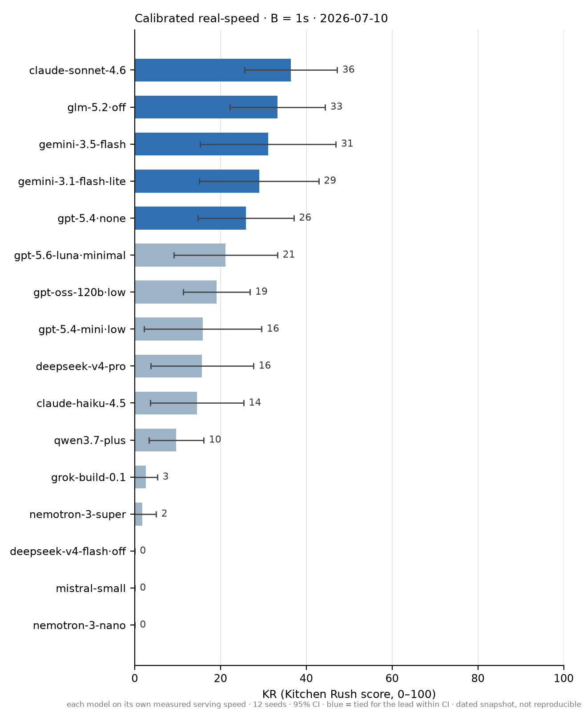
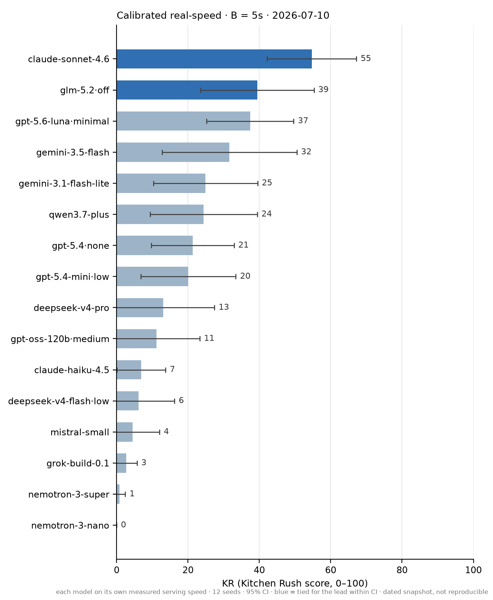

**An agent tool-calling benchmark where speed matters as much as intelligence.**

<p>
  <a href="LICENSE"></a>
  
</p>

<p align="center">
  
</p>

## Why this exists

Most tool-calling benchmarks check *whether* a model makes the right calls — and the world
politely waits while it thinks. But if you're building a voice assistant or anything realtime,
you care about two things at once: does the model do the right thing, **and does it do it fast
enough?**

Kitchen Rush measures both at once with one rule: **the time a model spends thinking is charged
to the game clock before its actions execute.** While the model deliberates, food keeps cooking,
food burns, and order deadlines slip away. Speed and accuracy aren't two charts you squint at —
they're one score.

## How it works

The model plays a chef in an [Overcooked](https://github.com/HumanCompatibleAI/overcooked_ai)-style
kitchen. Orders stream in (burgers, soups, ramen…), and the model fulfils them with ordinary
function calls — `collect`, `chop`, `cook`, `plate`, `serve` — racing deadlines, burn timers,
and a combo bonus for consecutive successful dishes. Three changes from Overcooked:

1. **Latency is the game.** Thinking time is charged to the shared clock, then actions execute.
   A model can chain several calls in one response and pay the latency once.
2. **The chef walks itself.** Travel happens automatically inside each action. What's tested is
   choosing the right action sequence under time pressure, not video-game reflexes.
3. **Deterministic.** The same seed and action sequence reproduce the same episode exactly, and
   every run replays in a browser viewer.

Every episode produces a single 0–100 score, **KR**. It's graded on a curve between two anchors:
KR 0 means "no better than doing nothing," KR 100 means "matched a scripted reference chef that
plays the same kitchen with zero latency." Worked example: if doing nothing finishes at −60, the
reference chef at +140, and your model at +40, your model covered 100 of the 200 points between
the anchors — KR 50. Average over many seeded kitchens for the leaderboard number
([docs/METHODOLOGY.md](docs/METHODOLOGY.md) has the full formula).

## The latency budget

Each kitchen is generated at a **latency budget** (`--latency-budget`, seconds per decision):
deadlines are priced so a chef deciding in exactly that many seconds per move can finish every
order, with roughly 50% headroom to spare. Decide faster than the budget and you bank slack;
decide slower and orders start becoming unfinishable. Each budget gets its own leaderboard —
results are never averaged together.

In deployment terms: the winner at a 1-second budget is the pick when every decision must land
in about a second (what a voice agent needs); a 5-second budget suits an interactive assistant
that can afford a short burst of reasoning. The same model can rank very differently at the two
budgets — that reordering is precisely what the benchmark is for.

## Leaderboard

Models are clocked on their own real, measured API latency: we sample each model's live serving
speed, freeze it, and run the game on that clock. Slow in production, slow on the board.

<p align="center">
  
  
</p>

16 models · 12 seeds · snapshot **2026-07-10**. Bars are mean KR, whiskers are 95% confidence
intervals; blue = tied for the lead. Full tables (including cost and per-model speed
measurements): [leaderboard/results/calibrated_board.md](leaderboard/results/calibrated_board.md).

`claude-sonnet-4.6` leads both budgets (KR 36 at 1s, 55 at 5s); `glm-5.2` is runner-up at both,
roughly 10× cheaper. Under 1-second pressure the fast, low-reasoning models hold the podium;
give each decision five seconds and the reasoners climb. Same models, different budget,
different winner.

One caveat: this board is clocked on dated, real-world API measurements, so it's a snapshot of
that day rather than a reproducible artifact ([docs/LIMITATIONS.md](docs/LIMITATIONS.md)).

## Try it

Watch a game in the browser (scripted chef, no model calls):

```bash
pip install -e .                          # the core has zero dependencies
kitchenrush replay --oracle --tier easy --seed 0       # writes ui/replays/easy_seed0.json
cd ui && python3 -m http.server 8000                   # then open http://localhost:8000
# ...or race up to 4 models side-by-side on one clock: ?replays=a.json,b.json (see ui/README.md)
```

Benchmark a real model:

```bash
pip install -e '.[providers]'
kitchenrush bench --model anthropic:claude-sonnet-4-6 --tier medium --latency-budget 1
```

Any LiteLLM-routable model works via `provider:model`. Other CLI commands (`run`, `bench`,
`replay`, `seeds`, `calibrate`) and custom-client support are covered in the docs below.

## Learn more

- [docs/METHODOLOGY.md](docs/METHODOLOGY.md) — scoring, statistics, and the latency-budget math
- [docs/](docs) — ruleset, calibration evidence, limitations, and the submission guide

## Citation

If you use Kitchen Rush in your work, please cite it (machine-readable copy in
[CITATION.cff](CITATION.cff)):

```bibtex
@software{kitchenrush2026,
  author = {Eledath, Bassim},
  title  = {Kitchen Rush: A Benchmark for Accurate and Fast Tool Calling},
  url    = {https://github.com/bassimeledath/kitchen-rush},
  year   = {2026}
}
```

## License

Apache-2.0. See [LICENSE](LICENSE).
