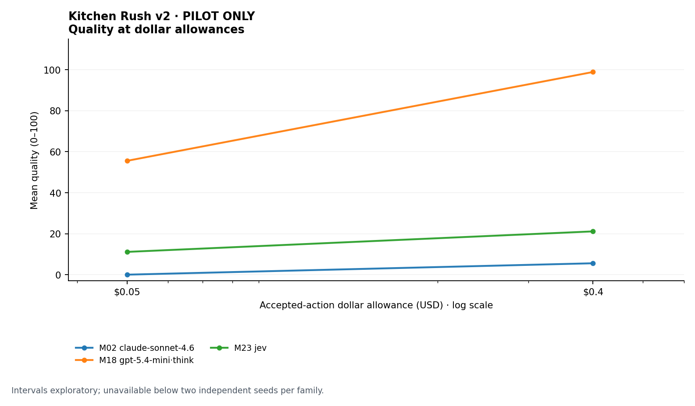
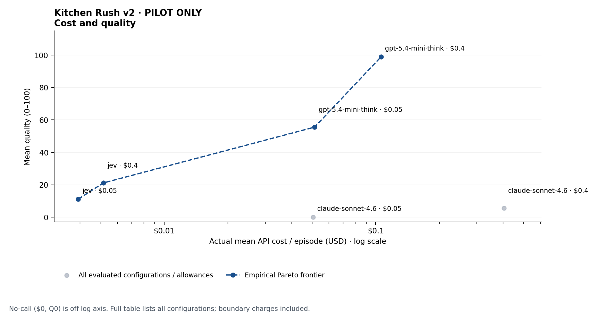
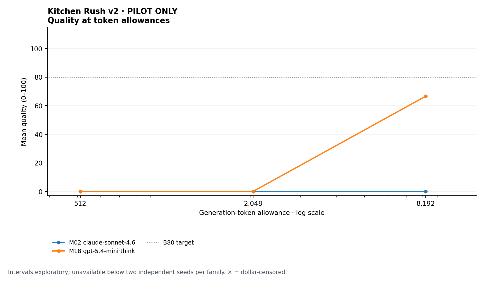

> Historical r1 pilot at a 2,048-token per-request ceiling. These are diagnostic results; r2 uses a revised configuration and fresh runs.

# Kitchen Rush v2 — audited results

**PILOT ONLY.**

Useful work. Limited budgets. Unfamiliar kitchens.

Canaries and pilots are diagnostic controls. Main and confirmation results remain separate; only main_1 and main_2 are pooled. No old pilot or v1 score enters these results.

Quality is 100 × max(0, (completed orders − 0.1 × invalid actions) / requested orders). Trials average within kitchen, kitchens within recipe-size family, then families equally. Error bars are exploratory pointwise 95% within-family seed bootstrap intervals; fewer than two independent seeds in any represented family means unavailable. Few seeds cannot establish stable ranks.

Dollar allowances fund the accepted action prefix. The first response crossing the allowance is paid but not executed. **Actual-cost graphs include that boundary response.** These graphs are conditional on complete protocol runs; failed-attempt spending is listed separately. No latency enters scoring or figures.

## Full roster coverage

| ID | Configuration | PILOT ONLY |
|---|---|---|
| M01 | claude-haiku-4.5 | Not tested in this cohort |
| M02 | claude-sonnet-4.6 | 9 audited episodes |
| M03 | claude-sonnet-4.6·think† | Not tested in this cohort |
| M04 | claude-sonnet-5 | Not tested in this cohort |
| M05 | deepseek-v4-flash | Not tested in this cohort |
| M06 | deepseek-v4-flash·think | Not tested in this cohort |
| M07 | deepseek-v4-pro | Not tested in this cohort |
| M08 | gemini-3.1-flash-lite | Not tested in this cohort |
| M09 | gemini-3.5-flash | Blocked: OpenRouter mandatory reasoning; direct API off support and billing unverified. |
| M10 | gemini-3.5-flash-lite | Not tested in this cohort |
| M11 | gemini-3.5-flash·think | Not tested in this cohort |
| M12 | gemini-3.6-flash·low | Not tested in this cohort |
| M13 | gemini-3.7-flash·low | Not tested in this cohort |
| M14 | glm-5.2 | Not tested in this cohort |
| M15 | glm-5.3-flash | Not tested in this cohort |
| M16 | gpt-5.4 | Not tested in this cohort |
| M17 | gpt-5.4-mini | Not tested in this cohort |
| M18 | gpt-5.4-mini·think | 9 audited episodes |
| M19 | gpt-5.4·think | Not tested in this cohort |
| M20 | gpt-5.6-luna | Not tested in this cohort |
| M21 | gpt-oss-120b·think | Not tested in this cohort |
| M22 | grok-build·think | Not tested in this cohort |
| M23 | jev | 6 audited episodes |
| M24 | llama-4-scout | Not tested in this cohort |
| M25 | mistral-small | Not tested in this cohort |
| M26 | nemotron-3-nano | Not tested in this cohort |
| M27 | nemotron-3-super | Not tested in this cohort |
| M28 | nemotron-3-ultra | Not tested in this cohort |
| M29 | phonellm-alpha-1† | Blocked: No verified dedicated-container cost allocation or resource cap; no v2 strict-choice adapter. |
| M30 | qwen3.7-plus | Not tested in this cohort |

## PILOT ONLY

24 audited episodes from corrected_pilot. Recipe split: pilot.

The frontier uses observed means and a no-call ($0, quality 0) reference. This reference is off the log axis. Positive-cost zero-quality points are dominated. It is not a claim of statistical dominance. Gray points/lines remain in the complete table. Zero-cost cells remain in the table but cannot appear on the logarithmic cost axis.

| ID / configuration | View | Allowance | Quality | 95% interval | Seeds / family | Actual cost | Boundary cost | Orders completed | Invalid actions | Frontier |
|---|---|---:|---:|---|---|---:|---:|---:|---:|---|
| M02 claude-sonnet-4.6 | USD | $0.05 | 0.0 | Unavailable | 2: 1, 3: 1, 4: 1 | $0.050537 | $0.012686 | 0.0% | 0.00 | — |
| M02 claude-sonnet-4.6 | USD | $0.4 | 5.6 | Unavailable | 2: 1, 3: 1, 4: 1 | $0.404453 | $0.013083 | 33.3% | 10.00 | — |
| M02 claude-sonnet-4.6 | tokens | 512 | 0.0 | Unavailable | 3: 1 | $0.387387 | $0.000000 | 0.0% | 12.00 | — |
| M02 claude-sonnet-4.6 | tokens | 2,048 | 0.0 | Unavailable | 3: 1 | $0.796890 | $0.000000 | 33.3% | 25.00 | — |
| M02 claude-sonnet-4.6 | tokens | 8,192 | 0.0 | Unavailable | 3: 1 | $0.769944 | $0.000000 | 33.3% | 19.00 | — |
| M18 gpt-5.4-mini·think | USD | $0.05 | 55.6 | Unavailable | 2: 1, 3: 1, 4: 1 | $0.051408 | $0.003245 | 55.6% | 0.00 | Yes |
| M18 gpt-5.4-mini·think | USD | $0.4 | 98.9 | Unavailable | 2: 1, 3: 1, 4: 1 | $0.105907 | $0.000000 | 100.0% | 0.33 | Yes |
| M18 gpt-5.4-mini·think | tokens | 512 | 0.0 | Unavailable | 3: 1 | $0.008343 | $0.000000 | 0.0% | 1.00 | — |
| M18 gpt-5.4-mini·think | tokens | 2,048 | 0.0 | Unavailable | 3: 1 | $0.031128 | $0.000000 | 0.0% | 1.00 | — |
| M18 gpt-5.4-mini·think | tokens | 8,192 | 66.7 | Unavailable | 3: 1 | $0.114100 | $0.000000 | 66.7% | 0.00 | — |
| M23 jev | USD | $0.05 | 11.1 | Unavailable | 2: 1, 3: 1, 4: 1 | $0.003925 | $0.000000 | 11.1% | 8.33 | Yes |
| M23 jev | USD | $0.4 | 21.1 | Unavailable | 2: 1, 3: 1, 4: 1 | $0.005155 | $0.000000 | 33.3% | 6.67 | Yes |

### B80

Smallest tested generation-token allowance with mean quality ≥80. The conservative variant requires the lower pointwise 95% bound ≥80. It is exploratory, not a simultaneous 95% guarantee across the budget search. No interpolation; dollar-censored cells are excluded. Results apply only to this cohort's represented families.

| ID / configuration | B80 (tokens) | Conservative B80 |
|---|---|---|
| M01 claude-haiku-4.5 | Not tested in this cohort | Not tested |
| M02 claude-sonnet-4.6 | Not reached within tested budgets | Unavailable — insufficient seeds |
| M03 claude-sonnet-4.6·think† | Not tested in this cohort | Not tested |
| M04 claude-sonnet-5 | Not tested in this cohort | Not tested |
| M05 deepseek-v4-flash | Not tested in this cohort | Not tested |
| M06 deepseek-v4-flash·think | Not tested in this cohort | Not tested |
| M07 deepseek-v4-pro | Not tested in this cohort | Not tested |
| M08 gemini-3.1-flash-lite | Not tested in this cohort | Not tested |
| M09 gemini-3.5-flash | Blocked — OpenRouter mandatory reasoning; direct API off support and billing unverified. | N/A |
| M10 gemini-3.5-flash-lite | Not tested in this cohort | Not tested |
| M11 gemini-3.5-flash·think | Not tested in this cohort | Not tested |
| M12 gemini-3.6-flash·low | Not tested in this cohort | Not tested |
| M13 gemini-3.7-flash·low | Not tested in this cohort | Not tested |
| M14 glm-5.2 | Not tested in this cohort | Not tested |
| M15 glm-5.3-flash | Not tested in this cohort | Not tested |
| M16 gpt-5.4 | Not tested in this cohort | Not tested |
| M17 gpt-5.4-mini | Not tested in this cohort | Not tested |
| M18 gpt-5.4-mini·think | Not reached within tested budgets | Unavailable — insufficient seeds |
| M19 gpt-5.4·think | Not tested in this cohort | Not tested |
| M20 gpt-5.6-luna | Not tested in this cohort | Not tested |
| M21 gpt-oss-120b·think | Not tested in this cohort | Not tested |
| M22 grok-build·think | Not tested in this cohort | Not tested |
| M23 jev | N/A — generation-token accounting/enforcement not comparable | N/A |
| M24 llama-4-scout | Not tested in this cohort | Not tested |
| M25 mistral-small | Not tested in this cohort | Not tested |
| M26 nemotron-3-nano | Not tested in this cohort | Not tested |
| M27 nemotron-3-super | Not tested in this cohort | Not tested |
| M28 nemotron-3-ultra | Not tested in this cohort | Not tested |
| M29 phonellm-alpha-1† | Blocked — No verified dedicated-container cost allocation or resource cap; no v2 strict-choice adapter. | N/A |
| M30 qwen3.7-plus | Not tested in this cohort | Not tested |

### Penalty sensitivity

Recomputed from raw completed/invalid counts. The headline remains λ=0.1; clipping is applied per episode before averaging.

| ID / configuration | View | Allowance | λ=0 | λ=0.05 | λ=0.1 | λ=0.2 |
|---|---|---:|---:|---:|---:|---:|
| M02 claude-sonnet-4.6 | USD | 0.05 | 0.0 | 0.0 | 0.0 | 0.0 |
| M02 claude-sonnet-4.6 | USD | 0.4 | 33.3 | 16.7 | 5.6 | 0.0 |
| M02 claude-sonnet-4.6 | tokens | 512 | 0.0 | 0.0 | 0.0 | 0.0 |
| M02 claude-sonnet-4.6 | tokens | 2048 | 33.3 | 0.0 | 0.0 | 0.0 |
| M02 claude-sonnet-4.6 | tokens | 8192 | 33.3 | 1.7 | 0.0 | 0.0 |
| M18 gpt-5.4-mini·think | USD | 0.05 | 55.6 | 55.6 | 55.6 | 55.6 |
| M18 gpt-5.4-mini·think | USD | 0.4 | 100.0 | 99.4 | 98.9 | 97.8 |
| M18 gpt-5.4-mini·think | tokens | 512 | 0.0 | 0.0 | 0.0 | 0.0 |
| M18 gpt-5.4-mini·think | tokens | 2048 | 0.0 | 0.0 | 0.0 | 0.0 |
| M18 gpt-5.4-mini·think | tokens | 8192 | 66.7 | 66.7 | 66.7 | 66.7 |
| M23 jev | USD | 0.05 | 11.1 | 11.1 | 11.1 | 11.1 |
| M23 jev | USD | 0.4 | 33.3 | 22.2 | 21.1 | 20.0 |

## Spending and failed attempts

Total accounted: **$14.758857 / $200**. Brought forward from earlier protocols: $10.532555; current protocol: $4.226302. Current failed/incomplete attempts: $0.000000. Current unknown liability: $0.000000. These are campaign totals, including batches not selected for this report.

Known charges and retained unknown liabilities are separate. Jev dollar charges use reported input usage × frozen published tariff; OpenRouter uses reported usage.cost. TypeSafe's operational reserve is an estimate, not a guaranteed provider spending cap.

| Protocol | Attempt | Status | Known charges | Unknown liability |
|---|---|---|---:|---:|
| Historical | canary-mini-42000-0-d0.4-tNone | quarantined | $0.082204 | $0.018713 |

## Provenance

[Machine-readable plot data and hashes](release-assets/plot-data.json). Each requested batch was independently re-audited before report generation.

| Batch | Manifest SHA-256 | Independent gate SHA-256 |
|---|---|---|
| corrected_pilot | `3c672516254eaf6aff8d7a057bd394dc9975cb49c83d7a64c291f0eb7d48a81c` | `3541beb8ecb6fdf6ff295456742afcec3eb732297bd6fdc85a69a2400f2c279c` |
