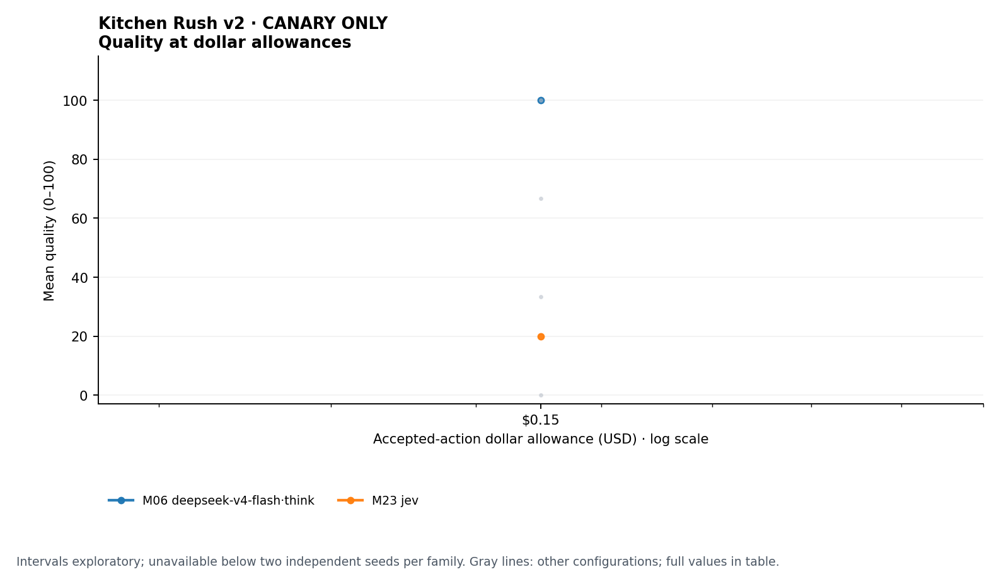
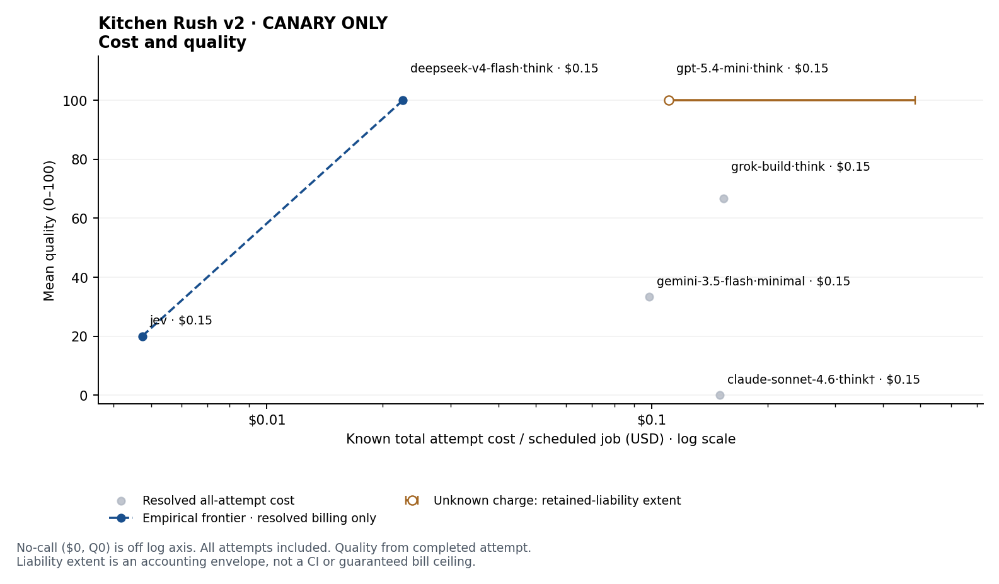

# Kitchen Rush v2 — audited results

**CANARY ONLY.**

Useful work. Limited budgets. Unfamiliar kitchens.

Canaries and pilots are diagnostic controls. Main and confirmation results remain separate. Main batches pool matched dollar/token cells and repeated trials, with trials averaged within kitchens. No old pilot or v1 score enters these results.

Quality is 100 × max(0, (completed orders − 0.1 × invalid actions) / requested orders). Trials average within kitchen, kitchens within recipe-size family, then families equally. Error bars are exploratory pointwise 95% within-family seed bootstrap intervals; fewer than two independent seeds in any represented family means unavailable. Few seeds cannot establish stable ranks.

Dollar allowances fund the accepted action prefix. The first response crossing the allowance is paid but not executed. **Graphs include known charges from every attempt of each scheduled job, including boundary responses and interrupted prefixes.** Quality comes from the audited completed attempt. Unknown charges are shown as retained-liability extents; these are accounting envelopes, not confidence intervals or guaranteed bill ceilings. Unresolved-cost points cannot enter the exact frontier. A documented transport failure permits one replacement of the same job; the original trace and all liability remain in the campaign accounting. Scores never qualify for a retry. No latency enters scoring or figures.

## Full roster coverage

Blocked reasons below record eligibility at roster freeze. Later isolated probes do not change this campaign's eligibility. See the [PhoneLLM inclusion review](PHONELLM_INCLUSION_REVIEW.md) for current progress.

| ID | Configuration | CANARY ONLY |
|---|---|---|
| M01 | claude-haiku-4.5 | Not tested in this cohort |
| M02 | claude-sonnet-4.6 | Not tested in this cohort |
| M03 | claude-sonnet-4.6·think† | 1 audited episode |
| M04 | claude-sonnet-5 | Not tested in this cohort |
| M05 | deepseek-v4-flash | Not tested in this cohort |
| M06 | deepseek-v4-flash·think | 1 audited episode |
| M07 | deepseek-v4-pro | Not tested in this cohort |
| M08 | gemini-3.1-flash-lite | Not tested in this cohort |
| M09 | gemini-3.5-flash·minimal | 1 audited episode |
| M10 | gemini-3.5-flash-lite | Not tested in this cohort |
| M11 | gemini-3.5-flash·think | Not tested in this cohort |
| M12 | gemini-3.6-flash·low | Not tested in this cohort |
| M13 | gemini-3.7-flash·low | Not tested in this cohort |
| M14 | glm-5.2 | Not tested in this cohort |
| M15 | glm-5.3-flash | Not tested in this cohort |
| M16 | gpt-5.4 | Not tested in this cohort |
| M17 | gpt-5.4-mini | Not tested in this cohort |
| M18 | gpt-5.4-mini·think | 1 audited episode |
| M19 | gpt-5.4·think | Not tested in this cohort |
| M20 | gpt-5.6-luna | Not tested in this cohort |
| M21 | gpt-oss-120b·think | Not tested in this cohort |
| M22 | grok-build·think | 1 audited episode |
| M23 | jev | 1 audited episode |
| M24 | llama-4-scout | Not tested in this cohort |
| M25 | mistral-small | Not tested in this cohort |
| M26 | nemotron-3-nano | Not tested in this cohort |
| M27 | nemotron-3-super | Not tested in this cohort |
| M28 | nemotron-3-ultra | Not tested in this cohort |
| M29 | phonellm-alpha-1† | Blocked at roster freeze: No verified dedicated-container cost allocation or resource cap; no v2 strict-choice adapter. |
| M30 | qwen3.7-plus | Not tested in this cohort |

## CANARY ONLY

6 audited episodes from revised_canary. Recipe split: development.

The frontier uses observed means and a no-call ($0, quality 0) reference. This reference is off the log axis. Positive-cost zero-quality points are dominated. It is not a claim of statistical dominance. Its comparison set contains only resolved-cost points. Gray points/lines remain in the complete table. Truncation counts include paid boundary replies; 0/0 means no generative replies. Zero-cost cells remain in the table but cannot appear on the logarithmic cost axis.

| ID / configuration | View | Allowance | Quality | 95% interval | Seeds / family | Known all-attempt cost | Boundary cost | Orders completed | Invalid actions | Truncated replies | Frontier |
|---|---|---:|---:|---|---|---:|---:|---:|---:|---|---|
| M03 claude-sonnet-4.6·think† | USD | $0.15 | 0.0 | Unavailable | 3: 1 | $0.150342 | $0.012642 | 0.0% | 1.00 | 0/11 | — |
| M06 deepseek-v4-flash·think | USD (replacement-affected) | $0.15 | 100.0 | Unavailable | 3: 1 | $0.022582 | $0.000000 | 100.0% | 0.00 | 0/30 | Yes |
| M09 gemini-3.5-flash·minimal | USD | $0.15 | 33.3 | Unavailable | 3: 1 | $0.098602 | $0.000000 | 66.7% | 10.00 | 0/25 | — |
| M18 gpt-5.4-mini·think | USD (replacement-affected) | $0.15 | 100.0 | Unavailable | 3: 1 | $0.110772 | $0.000000 | 100.0% | 0.00 | 0/23 | Unresolved billing |
| M22 grok-build·think | USD | $0.15 | 66.7 | Unavailable | 3: 1 | $0.153944 | $0.006520 | 66.7% | 0.00 | 0/17 | — |
| M23 jev | USD | $0.15 | 20.0 | Unavailable | 3: 1 | $0.004742 | $0.000000 | 33.3% | 4.00 | 0/0 | Yes |

### Attempts and cost accounting

Costs sum attempts within each scheduled job, then use the same kitchen/family weighting as quality. Replacements do not add independent statistical samples. A fully audited batch requires every scheduled job to finish; partial batches are not silently reduced to successful jobs. Peer accounting pauses are harness interruptions, not provider failures.

| Configuration / allowance | Completed / scheduled jobs | First-attempt completions | Attempts | Provider failures | Peer pauses | Completed-attempt cost | Known all-attempt cost | Unknown retained liability |
|---|---:|---:|---:|---:|---:|---:|---:|---:|
| M03 / 0.15 USD | 1/1 | 1 | 1 | 0 | 0 | $0.150342 | $0.150342 | $0.000000 |
| M06 / 0.15 USD | 1/1 | 0 | 2 | 0 | 1 | $0.019222 | $0.022582 | $0.000000 |
| M09 / 0.15 USD | 1/1 | 1 | 1 | 0 | 0 | $0.098602 | $0.098602 | $0.000000 |
| M18 / 0.15 USD | 1/1 | 0 | 2 | 1 | 0 | $0.084046 | $0.110772 | $0.373728 |
| M22 / 0.15 USD | 1/1 | 1 | 1 | 0 | 0 | $0.153944 | $0.153944 | $0.000000 |
| M23 / 0.15 USD | 1/1 | 1 | 1 | 0 | 0 | $0.004742 | $0.004742 | $0.000000 |

### B80

Smallest tested generation-token allowance with mean quality ≥80. The conservative variant requires the lower pointwise 95% bound ≥80. It is exploratory, not a simultaneous 95% guarantee across the budget search. No interpolation; dollar-censored and replacement-affected cells are excluded in full. A replacement resets the wallet, so its final score cannot prove that the scheduled job including its failed prefix fit the stated token budget. Results apply only to this cohort's represented families.

| ID / configuration | B80 (tokens) | Conservative B80 |
|---|---|---|
| M01 claude-haiku-4.5 | Not tested in this cohort | Not tested |
| M02 claude-sonnet-4.6 | Not tested in this cohort | Not tested |
| M03 claude-sonnet-4.6·think† | Not tested in this cohort | Not tested |
| M04 claude-sonnet-5 | Not tested in this cohort | Not tested |
| M05 deepseek-v4-flash | Not tested in this cohort | Not tested |
| M06 deepseek-v4-flash·think | Not tested in this cohort | Not tested |
| M07 deepseek-v4-pro | Not tested in this cohort | Not tested |
| M08 gemini-3.1-flash-lite | Not tested in this cohort | Not tested |
| M09 gemini-3.5-flash·minimal | Not tested in this cohort | Not tested |
| M10 gemini-3.5-flash-lite | Not tested in this cohort | Not tested |
| M11 gemini-3.5-flash·think | Not tested in this cohort | Not tested |
| M12 gemini-3.6-flash·low | Not tested in this cohort | Not tested |
| M13 gemini-3.7-flash·low | Not tested in this cohort | Not tested |
| M14 glm-5.2 | Not tested in this cohort | Not tested |
| M15 glm-5.3-flash | Not tested in this cohort | Not tested |
| M16 gpt-5.4 | Not tested in this cohort | Not tested |
| M17 gpt-5.4-mini | Not tested in this cohort | Not tested |
| M18 gpt-5.4-mini·think | Not tested in this cohort | Not tested |
| M19 gpt-5.4·think | Not tested in this cohort | Not tested |
| M20 gpt-5.6-luna | Not tested in this cohort | Not tested |
| M21 gpt-oss-120b·think | Not tested in this cohort | Not tested |
| M22 grok-build·think | Not tested in this cohort | Not tested |
| M23 jev | N/A — generation-token accounting/enforcement not comparable | N/A |
| M24 llama-4-scout | Not tested in this cohort | Not tested |
| M25 mistral-small | Not tested in this cohort | Not tested |
| M26 nemotron-3-nano | Not tested in this cohort | Not tested |
| M27 nemotron-3-super | Not tested in this cohort | Not tested |
| M28 nemotron-3-ultra | Not tested in this cohort | Not tested |
| M29 phonellm-alpha-1† | Blocked at roster freeze — No verified dedicated-container cost allocation or resource cap; no v2 strict-choice adapter. | N/A |
| M30 qwen3.7-plus | Not tested in this cohort | Not tested |

### Penalty sensitivity

Recomputed from raw completed/invalid counts. The headline remains λ=0.1; clipping is applied per episode before averaging.

| ID / configuration | View | Allowance | λ=0 | λ=0.05 | λ=0.1 | λ=0.2 |
|---|---|---:|---:|---:|---:|---:|
| M03 claude-sonnet-4.6·think† | USD | 0.15 | 0.0 | 0.0 | 0.0 | 0.0 |
| M06 deepseek-v4-flash·think | USD | 0.15 | 100.0 | 100.0 | 100.0 | 100.0 |
| M09 gemini-3.5-flash·minimal | USD | 0.15 | 66.7 | 50.0 | 33.3 | 0.0 |
| M18 gpt-5.4-mini·think | USD | 0.15 | 100.0 | 100.0 | 100.0 | 100.0 |
| M22 grok-build·think | USD | 0.15 | 66.7 | 66.7 | 66.7 | 66.7 |
| M23 jev | USD | 0.15 | 33.3 | 26.7 | 20.0 | 6.7 |

## Spending and failed attempts

Total accounted: **$22.089842 / $200**. Brought forward from earlier protocols: $16.175129; current protocol: $5.914713. Current failed/incomplete attempts: $5.403814. Current unknown liability: $5.373728. These are campaign totals, including batches not selected for this report.

Known charges and retained unknown liabilities are separate. Jev dollar charges use reported input usage × frozen published tariff; OpenRouter uses reported usage.cost. TypeSafe's operational reserve is an estimate, not a guaranteed provider spending cap.

| Protocol | Attempt | Status | Known charges | Unknown liability |
|---|---|---|---:|---:|
| Current | phonellm-sandbox-probe-20260917-1 | billing_pending | $0.000000 | $5.000000 |
| Current | revised_canary-deepseek-v4-flash-think-60000-3-0-d0.15-tNone | incomplete | $0.003360 | $0.000000 |
| Current | revised_canary-gpt-5-4-mini-think-60000-3-0-d0.15-tNone | quarantined | $0.026726 | $0.373728 |
| Historical | roster_canary-deepseek-v4-flash-think-56300-3-0-d0.4-tNone | quarantined | $0.005925 | $0.094740 |
| Historical | canary-mini-42000-0-d0.4-tNone | quarantined | $0.082204 | $0.018713 |

## Provenance

[Machine-readable plot data and hashes](release-r2-assets/plot-data.json). Each requested batch was independently re-audited before report generation.

| Batch | Manifest SHA-256 | Independent gate SHA-256 |
|---|---|---|
| revised_canary | `e989fcfe63e2e1122f6158ac50a4152036ae534ad13100e4a7e8784b8b7e0db3` | `281eff48a052609a72b727402005be429996e0750015fdbc28a33712f32bde21` |
