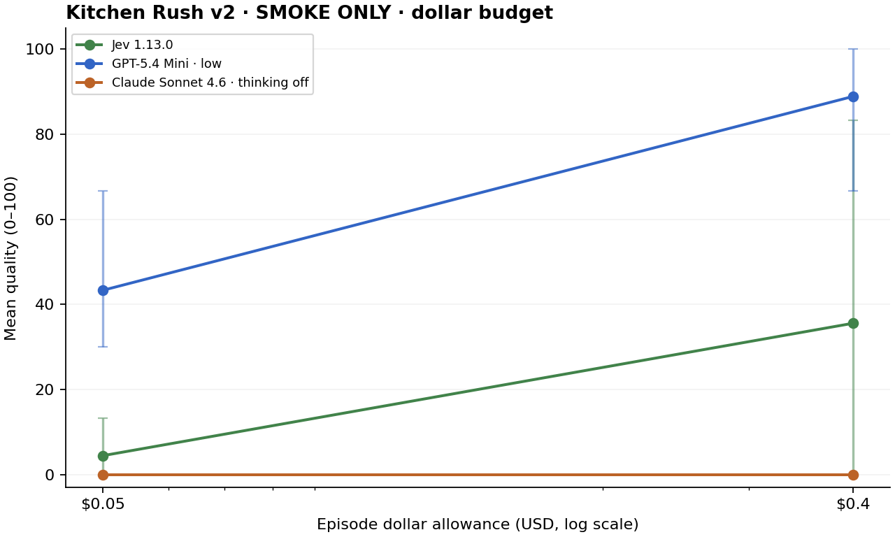
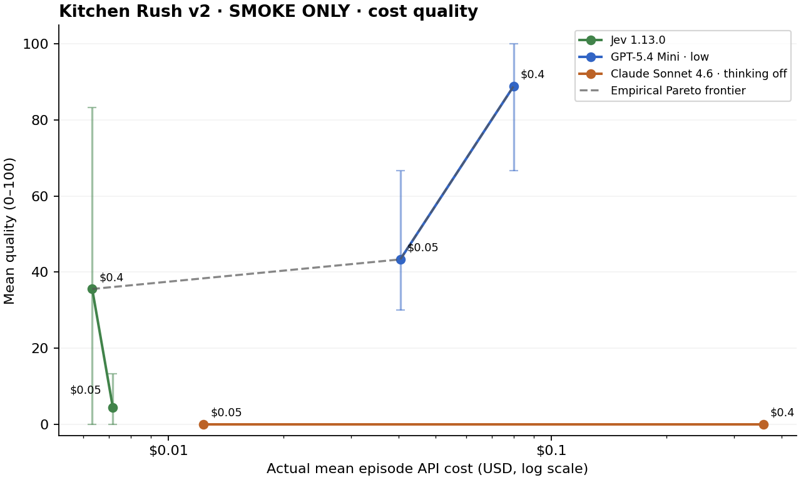

# Checkpoint 2 — smoke results

**18 audited episodes; 462 verified API requests.** These are pilot controls, not the full model leaderboard.

| Configuration | View | Allowance | Quality | 95% CI | Mean cost | Complete orders | Invalid calls |
|---|---|---:|---:|---|---:|---:|---:|
| Jev 1.13.0 | USD | 0.05 | 4.4 | 0.0–13.3 | $0.0072 | 22% | 14.3 |
| Jev 1.13.0 | USD | 0.4 | 35.6 | 0.0–83.3 | $0.0063 | 56% | 9.0 |
| GPT-5.4 Mini · low | USD | 0.05 | 43.3 | 30.0–66.7 | $0.0404 | 44% | 0.3 |
| GPT-5.4 Mini · low | USD | 0.4 | 88.9 | 66.7–100.0 | $0.0798 | 89% | 0.0 |
| Claude Sonnet 4.6 · thinking off | USD | 0.05 | 0.0 | 0.0–0.0 | $0.0124 | 0% | 0.0 |
| Claude Sonnet 4.6 · thinking off | USD | 0.4 | 0.0 | 0.0–0.0 | $0.3583 | 0% | 13.0 |

Repeated trials are averaged within seed; intervals resample seeds. Small pilot samples cannot establish stable ranks. USD and token experiments are separate. Token cells stopped by the operational dollar backstop cannot establish B80.

The reservation policy can leave dollars unspent: it must cover a conservative input-token bound before sending another request. Especially at small allowances, these curves measure the configured model plus this spending policy. Review this effect before a release; do not interpret early stopping as the model choosing to stop. The zero floor also makes some episodes with completed orders score zero after invalid-action penalties; completion and invalid counts remain essential.

## B80

- Jev 1.13.0: N/A — generation-token comparability/enforcement not established.
- GPT-5.4 Mini · low: Not tested in this stage.
- Claude Sonnet 4.6 · thinking off: Not tested in this stage.

## Spending

This stage: $1.5132. Total accounted across stages: **$10.5326 / $50**. Recorded usage charges: $10.5138; permanently retained liability for abandoned attempts: $0.0187. No reserve is counted as a known invoice.

Jev cost uses its published input-token tariff; OpenRouter cost comes from response usage. Output tokens are recorded for both, including Jev probability output. No network timing enters the charts.

Protocol source hash: `b5054321ecbc7a3e69048f3d6aad761a5b0ffc94f9dfb0d356ab7d59196a8d35`.

