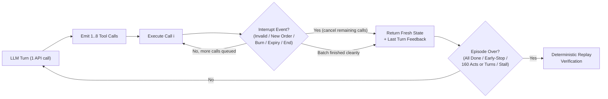

# Kitchen Rush v3: Full Design Document

> **One-sentence summary:** Kitchen Rush v3 is a tunable-difficulty **native tool-calling & token-efficiency benchmark** where a single AI chef manages an unfamiliar, procedurally generated kitchen under tight physical bottlenecks and deadlines—scaling cleanly from `D=1` (simple serial execution) to `D=5` (parallel 4-burner rush with razor margins).

---

## 1. The Core Vision & Honest Framing

Why do static LLM benchmarks saturate within 6–12 months? Because they are **finite exams** whose questions leak into training data.

**Kitchen Rush v3** tests real-time agentic planning and token efficiency on **fresh procedural kitchens**:
* **Practical native interface:** Instead of toy board moves or huge text menus, the model uses **8 clean JSON function-calling tools** (`collect`, `chop`, `cook`, `collect_cooked`, `plate`, `serve`, `discard`, `wait`) to manage inventory, parallel timers, and unexpected interruptions.
* **The "Infinite Kitchen" (Anti-Memorization):** Every seed generates fresh cook times, fresh burn windows, fresh recipes, shuffled stations (`D >= 3`), and fresh preparation rules (whether *any* cookable ingredient must be `RAW` or `CHOPPED` before hitting a stove). Combined with **fresh private evaluation seeds** (keeping `calibration_bank_v1.json` strictly as a public dev set), memorization fails immediately.
* **The Core Thesis (Token & Dollar Efficiency vs. Complexity):** Small, cheap models should crush expensive frontier models on **dollars per cleared order** when complexity $D$ is low—until rising complexity causes small models to fail full clears or burn excessive reasoning tokens, creating a measurable **efficiency crossover** where stronger models win.

### Honest Framing: The Witness Solver vs. Chess
A sharp question anyone should ask: *If a deterministic Python solver can beat every kitchen, doesn't that invalidate the benchmark?*

* **What the witness solver is (and isn't):** Finding the mathematically *shortest possible* schedule with walking times, burn windows, and hidden arrivals is NP-hard. Our `scheduled_witness` is **not** an optimal solver—it is a **feasibility certificate** ("at least one valid, burn-free schedule beats the deadlines"), like playtesting a puzzle before publishing it.
* **What our audit proved:** Because deadlines are anchored to `scheduled_witness` (`deadline = witness_serve_time + slack`), even a **no-oracle** version of that ~200-line Python scheduler (with future-arrival peeking disabled) clears **100% of accepted `D=1..5` kitchens** in-process.
* **Why the benchmark still measures something real (the Stockfish analogy):** In Chess, Stockfish crushes every human and LLM—yet asking an LLM to play Chess *natively from board state without Stockfish* still exposes real planning limits. Likewise, in Kitchen Rush v3 the LLM has **no Python interpreter**: it must track concurrent timers in working memory, emit valid native tool calls in real time, and spend tokens efficiently. We disclose the no-oracle scheduler openly as our **"par / Stockfish" reference**, rather than claiming no heuristic can solve `D=1..5`.

---

## 2. Plain-English Glossary of Every Term

| Term | Plain-English Meaning | Everyday Analogy |
| :--- | :--- | :--- |
| **Episode / Kitchen / Seed** | One complete game generated deterministically from `(seed, D)`. Same `(seed, D)` = identical kitchen for every model. | One specific dinner service played by every competitor. |
| **Game-seconds (`gs`)** | Simulated time inside the kitchen. **Pauses while the LLM thinks.** Only executed tool actions advance the clock. | A chess clock that stops while you think and ticks only when pieces move—slow internet or GPU latency never skews scores. |
| **Action vs. Turn vs. Batch** | An **action** is one tool call (`collect`, `cook`, etc.). A **turn** is one LLM API call. A **batch** is 1 to 8 actions queued in a single turn. | Saying *"grab patty, chop it, put it on burner 0"* in one breath (1 turn, 3 actions) instead of pausing after every motion (3 turns). |
| **Event-Driven Interrupt** | If an action in a batch hits an unexpected event (**invalid action**, **new hidden order arrives**, **food burns**, or **order expires**), all *subsequent* queued calls in that batch are cancelled and control returns to the chef. | You planned 5 steps ahead, then the ticket printer *dings* with a surprise rush order after step 2—you pause and re-plan. |
| **Full Clear ("Clear")** | Serving **100% of the orders** in a kitchen with zero expirations ($S_e = N_e$). Primary pass/fail outcome. | Finishing the entire dinner service with zero walk-outs. |
| **Order Completion** | Fraction of all requested orders served before their deadlines ($\sum S_e / \sum N_e$). Partial credit shown alongside Full Clears. | Serving 4 out of 5 tables on time = 80% Order Completion. |
| **Witness Solver** | Deterministic offline scheduler run before any LLM sees a seed. Proves every admitted kitchen is solvable with 0 burns and 0 invalids, and anchors deadlines. | A playtester verifying a puzzle is genuinely solvable before publishing it. |
| **Provable Early-Stop** | Terminating an episode the instant it becomes *mathematically impossible* (even with free walking and relaxed capacity) to serve any remaining order on time. | Resigning when checkmate is unavoidable—preserves exact served count while saving wasted API turns. |
| **Prompt Caching / Cache %** | Putting static rules and kitchen spec at the start of the prompt so turns $2 \dots T$ reuse provider KV cache at 75–90% lower input price. | Reading the kitchen manual once at the start of your shift instead of re-reading all 10 pages every turn. |
| **Paired Seed Bootstrap** | Estimating uncertainty (95% CIs) by resampling matched **kitchen pairs** `{(A, B) on seed s}` 4,000 times. | Comparing two chefs on the exact same nights of dinner service so one unusually hectic night doesn't skew the gap. |

---

## 3. How the Kitchen Works (Mechanics, Interface & Simplifications)

### A. The 8 Native Tools (Zero Format Friction)
1. `collect(ingredient)` — Walk to dispenser and pick up 1 `RAW` unit into an empty hand slot (2s + walk).
2. `chop(ingredient)` — Walk to cutting board and chop a held `RAW` ingredient into `CHOPPED` (4s + walk).
3. `cook(ingredient)` — Walk to a free burner and start cooking a held ingredient matching `ingredient_rules.cookable_from` (2s + walk).
4. `collect_cooked(ingredient, burner_index?)` — Walk to a burner with a `READY` item and lift it into an empty hand slot (1s + walk; lifted off heat *on arrival* before handling time).
5. `plate(recipe)` — Walk to plating counter and assemble the recipe from held items (5s + walk). Exact match required; no extra unplated items (already-plated dishes in hand are allowed).
6. `serve(order_id)` — Walk to serving pass and deliver a held plated dish to an `ACTIVE` order (3s + walk).
7. `discard(item)` — Walk to bin and discard a held item or plate (1s + walk).
8. `wait(seconds)` — Advance the kitchen clock by an integer `1..120` game-seconds.

* **Automatic walking:** Every station tool walks automatically (`0.15s` per floor cell); no `move_to` micromanagement.
* **Atomic `wait(seconds)`:** A `wait(t)` runs to completion for the full `t` seconds; any arrival/expiry/burn that happens during the wait cancels *subsequent* queued calls after the wait, not the wait itself. Models must calculate wait durations rather than blindly calling `wait(120)`.
* **Invalid action penalty:** Illegal calls cost **3 game-seconds**, increment `invalid`, and interrupt the rest of that batch.
* **No hidden harness traps:**
  * **One generous output token ceiling (`max_tokens=16384`)** across every model so `reasoning_effort`—never silent truncation—governs thinking length. *(Our independent audit caught that an earlier `2048` cap silently truncated Haiku on 47 empty turns!)*
  * **Turn limit matches action limit (`max_turns = max_actions = 160`)**, so 1-call/turn models (like GPT-Sol or future 1-step `DecisionModelAdapter` models) are never secretly cut off at half budget.
  * **One atomic campaign spend cap** (reserving worst-case cost before each call and settling actual cost afterward) instead of scattered per-episode/per-model cutoffs.
  * **Full audit logging:** Every turn records `finish_reason`, `provider_route`, `requested_effort`, `max_tokens`, `empty_turns`, and `truncated_turns`.

### B. Batched Execution with Event-Driven Interrupts

### C. Context & Turn History Policy (Locked on Native `full_chat`)
Every turn keeps the static system prompt byte-identical and grows an append-only native multi-turn conversation (`history_mode="full_chat"`):
1. **Static System Prefix (cached across all turns):** Rules (prioritizing full kitchen clears, with partial credit tracked) + action durations + per-kitchen `ingredient_rules` + station coordinates (~1,350 tokens).
2. **Native Multi-Turn Transcript (`full_chat`, default for LLMs):** Standard OpenAI/Anthropic `user(STATE_JSON) → assistant(tool_calls) → tool(tool_result) → user(next STATE_JSON)` loop, with Anthropic ephemeral cache checkpoints on the growing prefix (yielding **80% cache hit rates on Anthropic** and **97–98% on OpenAI**).
3. **Stateless `last_turn` mode (for 1-step decision models):** Retained cleanly as `history_mode="last_turn"` for stateless 1-step policies (`DecisionModelAdapter` / TypeSafe Jev) that cannot hold a multi-turn chat transcript.

**Why `full_chat` won decisively (controlled 3-way A/B/C across both tiers):**
We dropped the arbitrary 5-turn window and tested three non-arbitrary policies head-to-head on matched seeds (`last_turn`, an optional zero-game-time `inspect_history(turns)` tool, and native `full_chat`):
* **Models ignored `inspect_history`:** Haiku called it **1 time in 18 episodes**; `gpt-6.2-sol-low` called it **0 times in 12 episodes**.
* **`full_chat` dominated on EVERY axis for BOTH small and frontier models:**
  * **Haiku 5.5 (`low`, `D=3`):** Clears jumped `0/6 → 2/6` (`79.2%`), output tokens dropped **~2×** (`144k` vs `283k` across D3–D5), and total USD spend dropped **20%** (`\$0.138` vs `\$0.173`).
  * **`gpt-6.2-sol-low` (`D=4, D=5`):** D=4 hit **6/6 full clears (100%, 0 invalids, 0 burns)** vs `5/6` (`last_turn`); D=5 clears quadrupled from **1/6 → 4/6 (94.4%)**; D=5 output tokens per cleared order fell **4×** (`1,765 → 435`); D=5 USD per cleared order fell **2.3×** (`\$0.1208 → \$0.0535`) with **97.3–98.1% prompt caching**.

---

## 4. The Tunable Complexity Dial: What Changes from $D = n$ to $D = n + 1$?

One unified parametric generator `generate_kitchen(seed, level=D)` controls all difficulty levels.

### Supported Range (`D = 1..5`) and Why There Is a Mathematical Ceiling

| Dial $D$ | Orders ($N$) | Burners ($B$) | Components / Order | Cooked / Order | Cook Time Range | Burn Window | Initial Active | Hidden Staggered Arrivals | Station Layout | Deadline Slack $\sigma(D)$ (min pad) |
| :-: | :-: | :-: | :-: | :-: | :-: | :-: | :-: | :--- | :-: | :-: |
| **D=1** | 2 | 2 | 2–3 | 1 | 8–14s | 14–18s | 2 | None (0 hidden) | Fixed | **+70%** (min 18s) |
| **D=2** | 3 | 3 | 3 | 1–2 | 18–28s | 12–16s | 3 | None (0 hidden) | Fixed | **+22%** (min 9s) |
| **D=3** | 4 | 3 | 3 | 1–2 | 22–36s | 10–14s | 3 | 1 hidden (+14–22s) | **Shuffled** | **+14%** (min 7s) |
| **D=4** | 5 | 4 | 3–4 | 2 | 26–44s | 9–12s | 3 | 2 hidden (+16–26s each) | **Shuffled** | **+9%** (min 5s) |
| **D=5** | 6 | 4 | 3–4 | 2 | 32–54s | 8–11s | 4 | 2 hidden (+16–24s each) | **Shuffled** | **+4%** (min 3s) |

*(At **every** level, all 5 cookable ingredients independently randomize `cookable_from ∈ {RAW, CHOPPED}`, `cook_time`, and `burn_window`.)*

* **About `D=6+` and the hard ceiling:** At `D >= 4`, every order requires at least 2 cooked components (6 actions) + 1 other component (≥1 action) + `plate` + `serve` = **at least 9 actions per order**. Under a fixed **160-action cap**, `18 orders × 9 = 162 > 160`, so `D=17` is provably impossible (and witness acceptance already drops to 0 by `D=14`, while `D=6` retains ~60% of seeds).
* **Policy:** **`D=1..5` is the official supported v3 suite.** We only extend to `D=6+` (and scale `max_actions` proportionally to `N`) if medium/high-effort frontier models actually saturate `D=5`.

### Plain-English Analogies: What Each Step $D \to D+1$ Feels Like
* **$D = 1$ ("Sunday dinner for two"):** 2 orders, 1 cooked item each, short cooks (8–14s), +70% slack. Doing orders one-at-a-time clears 100% of kitchens. *Tests basic native tool calling and reading randomized `cookable_from` rules.*
* **$D = 1 \to 2$ ("Three guests eating together"):** 3 orders, cook times double (18–28s), slack drops to +22%. Serial cooking now fails most full clears. *Forces basic parallel cooking across 3 burners.*
* **$D = 2 \to 3$ ("Friday lunch in a brand-new kitchen"):** 4 orders on 3 burners, **all station locations shuffle**, burn windows shrink (10–14s), slack drops to +14%, and **Order 4 arrives hidden mid-episode**. *Tests dynamic replanning under burner contention.*
* **$D = 3 \to 4$ ("Dinner rush on a 4-burner line"):** 5 orders, **every order needs 2 cooked items** (10 stove jobs), 3–4 ingredients/dish (hitting the 4-hand ceiling), 2 hidden arrivals, +9% slack. *Tests true multi-order pipelining without plating collisions.*
* **$D = 4 \to 5$ ("Peak Friday rush, razor margin"):** 6 orders (12 stove jobs), 32–54s unequal cooks, 8–11s burn windows, and only **+4% slack** (3s min pad). One early mistake cascades across the rush.

### Exact Deadline Calibration Math
1. Build the draft kitchen with unconstrained deadlines (`3000s`).
2. Run `scheduled_witness` on the draft kitchen and record the game-second $t_i^*$ when the witness initiates `serve` for each order $O_i$.
3. Compute active elapsed time since arrival $a_i$:
   $$\Delta_i = \max(10.0,\; t_i^* - a_i)$$
4. Set order $O_i$'s deadline with level slack $\sigma(D)$ and minimum pad $p_{\min}(D)$:
   $$\text{deadline}_i = \left\lceil t_i^* + \max\big(p_{\min}(D),\; \Delta_i \cdot \sigma(D)\big) \right\rceil$$
5. Replay the witness on the finalized kitchen and **reject the seed** unless it achieves `100% served`, `0 invalids`, and `0 burns` (bounded by `max_attempts` so bank building always terminates cleanly).

*Worked Example:* At $D=3$ ($\sigma = 0.14$, $p_{\min} = 7.0$), if `O2` arrives at $a_2 = 0$ and the witness starts serving at $t_2^* = 80.0\text{s}$:
$$\Delta_2 = 80.0\text{s}, \quad \text{pad} = \max(7.0,\; 80.0 \times 0.14) = 11.2\text{s}, \quad \text{deadline}_2 = \lceil 80.0 + 11.2 \rceil = 92\text{s}.$$

---

## 5. Scoring Metrics: Full-Clear Gated Efficiency + Partial Credit

For each `(model, level)` cell over scored episodes $e = 1, \dots, K$, let:
* $S_e$ = orders served before deadline; $N_e$ = orders requested
* $\text{Clear}_e = \mathbb{1}[S_e = N_e]$ (1 if the entire kitchen was cleared, else 0)
* $N_{\text{clear}, e} = N_e \cdot \text{Clear}_e$ (orders in fully cleared kitchens)
* $T_{\text{out}, e}$ = output tokens (including reasoning tokens)
* $C_e$ = actual provider-settled USD (directly from OpenRouter `usage.cost`, including real prompt cache reads/writes)
* $I_e$ = invalid tool calls; $B_e$ = burned items; $A_e$ = executed tool actions

| # | Metric | Formula | Direction | What It Measures |
| :-: | :--- | :---: | :-: | :--- |
| **1** | **Full Clears** *(+ Order Completion)* | $\dfrac{\sum_e \text{Clear}_e}{K}$ &nbsp;and&nbsp; $\dfrac{\sum_e S_e}{\sum_e N_e}$ | Higher | Primary pass/fail capability + partial progress within kitchens. |
| **2** | **Out Tok / Cleared Ord** | $\dfrac{\sum_e T_{\text{out}, e}}{\sum_e N_{\text{clear}, e}}$ | Lower | Total reasoning/output tokens spent across **all** attempts per order in a fully cleared kitchen (`no clear` if 0 clears). |
| **3** | **USD / Cleared Ord** | $\dfrac{\sum_e C_e}{\sum_e N_{\text{clear}, e}}$ | Lower | True economic cost across **all** attempts per order in a fully cleared kitchen (`no clear` if 0 clears). *(Secondary `USD / Served Ord` also shown.)* |
| **4** | **Reliability** | $\dfrac{100 \sum_e (I_e + B_e)}{\sum_e A_e}$ + Empty / Trunc turns | Lower | Invalid calls and burns per 100 actions, plus explicit empty-turn and token-cap truncation counts. |

**Why Full-Clear Gating matters (and why we dropped speculative D5 hacks):**
* If you divide dollars by *individually served orders*, a model that spends \$0.01 and cherry-picks 1 of 6 orders looks cheaper than a model that spends \$0.12 and clears all 6.
* Pooling **all** episode spend in the numerator and counting **cleared-kitchen orders** in the denominator fixes that completely—and naturally drives failed high-complexity cells to `0/6 clears` (`no clear`) while keeping Order Completion right next to it for partial progress.
* **Why we rejected speculative D5 "shared wave deadlines" and "two-strike" hacks:** Independent replay checks proved fixed wave targets like 105s are physically impossible on some D5 recipes (hard lower bound 113s on seed 3001), while two-strike rules distorted rankings on existing traces (penalizing models that recovered after early slips). Keeping pure kitchen physics + Full-Clear Gating is simpler, fairer, and free of arbitrary rule tweaks.

**Worked Example:** Two kitchens at $D=3$ ($N=4$ orders each):
* Kitchen 1: 4/4 served (**Full Clear**), 1,200 output tokens, \$0.04, 0 invalids, 0 burns, 36 actions.
* Kitchen 2: 3/4 served (*not a clear*), 1,600 output tokens, \$0.06, 1 invalid, 1 burn, 44 actions.
* **Full Clears:** `1/2` (50.0%) | **Order Completion:** `(4 + 3) / 8 = 87.5%`.
* **Out Tok / Cleared Ord:** `(1200 + 1600) / 4 = 700` tok/cleared-order.
* **USD / Cleared Ord:** `($0.04 + $0.06) / 4 = $0.0250` / cleared-order *(secondary USD / Served Ord = `\$0.10 / 7 = \$0.0143`)*.
* **Reliability:** `100 × (1 + 1) / (36 + 44) = 2.5` inv+burns per 100 actions (`0` empty turns, `0` truncated turns).

---

## 6. Empirical Validation Evidence (Calibration v1 + v2 + History A/B)

### A. Reasoning-Effort & Tier Crossover (`runs/v3/calibration_v2/`, `max_tokens=16384`, `last_turn`, 90/90 scored, \$5.48, 0 cap hits)

| Level | `claude-haiku-5.5-low` | `gpt-6.2-sol-low` | `gpt-6.2-sol-medium` | Winner on `USD / Cleared Ord` |
| :-: | :--- | :--- | :--- | :--- |
| **D=1** | **6/6 (\$0.0010)** | 6/6 (\$0.0100) | 6/6 (\$0.0122) | Small (`haiku`, 10× cheaper) |
| **D=2** | **2/6 (\$0.0042)** | 6/6 (\$0.0149) | 6/6 (\$0.0215) | Small (`haiku`, 3.5× cheaper) |
| **D=3** | 0/6 (`no clear`) | **4/6 (\$0.0229)** | 5/6 (\$0.0259) | Frontier `low` (`6.2-sol-low`) |
| **D=4** | 0/6 (`no clear`) | **5/6 (\$0.0246)** | 5/6 (\$0.0359) | Frontier `low` (`6.2-sol-low`, 4× fewer out tok) |
| **D=5** | 0/6 (`no clear`) | 1/6 (\$0.1208) | **2/6 (\$0.1025)** | **Frontier `medium` flips cheaper than `low`!** |

*(Across all 30 episodes of `gpt-6.2-sol-medium`, it made **0 invalid actions** and hit **0 empty/truncated turns**. Earlier v1 pilot on the same 6 seeds also showed `gemini-3.8-flash-low` winning `D=3` at \$0.0190 vs `gpt-6.1-sol-low` \$0.0274 before `gpt-6.1-sol-low` flipped ahead at `D=4` at \$0.0490 vs \$0.0651.)*

### B. 3-Way History Mode Comparison (`D=4..5` on `gpt-6.2-sol-low`, 6 matched seeds, 0 cap hits)

| Mode (`gpt-6.2-sol-low`) | D=4 Clears (Comp) | D=5 Clears (Comp) | D=5 Out Tok / Cleared Ord | D=5 USD / Cleared Ord | Cache % |
| :--- | :---: | :---: | ---: | ---: | :-: |
| `last_turn` *(1 turn)* | 5/6 (96.7%) | 1/6 (83.3%) | 1,765 | \$0.1208 | 72.1% |
| `on_demand` *(`inspect_history`)* | 3/6 (90.0%) | 1/6 (83.3%) | 2,056 | \$0.1320 | 71.6% |
| **`full_chat` *(locked default)*** | **6/6 (100.0%)** | **4/6 (94.4%)** | **435** | **\$0.0535** | **98.1%** |

**Headroom note for future official runs:** Under `full_chat`, `gpt-6.2-sol-low` already reaches `4/6` clears at `D=5`. Before publishing an official leaderboard with `medium`/`high` reasoning models under `full_chat`, we should check whether `D=5` saturates and—if so—include `D=6` (scaling `max_actions` proportionally with `N`).

### C. Pre-Leaderboard Checklist
1. **Generate fresh private held-out seeds** (e.g., 10–20 seeds/level kept outside Git; keep `calibration_bank_v1.json` as the public dev set).
2. **Verify Google/Gemini prompt caching on OpenRouter** (earlier Flash showed `0%` cache hits vs `70–98%` on Anthropic/OpenAI).
3. **Run all models under the single locked protocol:** `history_mode="full_chat"`, `max_tokens=16384`, `max_turns=160`, Full-Clear Gated metrics + loud Cap & Reliability Alerts.

---

## 7. Modular Architecture & Visual Replay Hook

All v3 code lives cleanly in 6 compact modules inside `src/kitchenrush/v3/`:
* [`env.py`](file:///Users/bassime/Desktop/fullstack/kitchen-rush/.worktrees/v3-unified/src/kitchenrush/v3/env.py) — `UnifiedEngine`, `difficulty_profile(D)`, `generate_kitchen(seed, D)`, 8 native `TOOL_SCHEMAS`, `static_context`, `dynamic_state` (`last_turn`), `verify_replay`.
* [`solvers.py`](file:///Users/bassime/Desktop/fullstack/kitchen-rush/.worktrees/v3-unified/src/kitchenrush/v3/solvers.py) — `run_sequential_solver`, `run_greedy_overlap_solver`, `scheduled_witness` (with `allow_arrival_peek=False` no-oracle reference mode).
* [`adapters.py`](file:///Users/bassime/Desktop/fullstack/kitchen-rush/.worktrees/v3-unified/src/kitchenrush/v3/adapters.py) — `AgentAdapter`, `OpenRouterToolAdapter` (uniform `max_tokens=16384`, caching, route/finish-reason capture), and `DecisionModelAdapter` (1-step base class for future TypeSafe / Jev integration).
* [`metrics.py`](file:///Users/bassime/Desktop/fullstack/kitchen-rush/.worktrees/v3-unified/src/kitchenrush/v3/metrics.py) — Full-clear gated primary metrics + partial credit + secondary per-served-order ratios + 4,000-draw paired-seed bootstrap CIs.
* [`runner.py`](file:///Users/bassime/Desktop/fullstack/kitchen-rush/.worktrees/v3-unified/src/kitchenrush/v3/runner.py) — Single atomic-reservation `SpendLedger`, `max_turns=160`, resumable seed-wave execution, mandatory `verify_replay`.
* [`replay.py`](file:///Users/bassime/Desktop/fullstack/kitchen-rush/.worktrees/v3-unified/src/kitchenrush/v3/replay.py) — Zero-cost exporter converting any v3 episode JSON into the existing pixel-art [ui/](file:///Users/bassime/Desktop/fullstack/kitchen-rush/ui/README.md) viewer format (supporting 1–4 model synchronized **Race Mode** duels).
