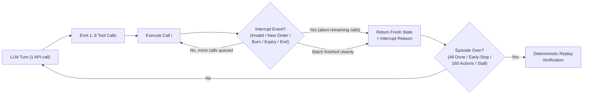

# Kitchen Rush v3: Full Design Document

> **One-sentence summary:** Kitchen Rush v3 is an unsaturable, tunable-difficulty **tool-calling & token-efficiency benchmark** where a single AI chef manages an unfamiliar, procedurally generated kitchen under tight physical bottlenecks and deadlines—scaling smoothly along one integer dial ($D = 1, 2, 3, \dots$) like expanding a chessboard.

---

## 1. The Core Vision & The Chessboard Analogy

Why do most LLM benchmarks saturate within 6–12 months? Because they are **static exams**—finite sets of trivia, coding puzzles, or fixed scripts that models eventually memorize or absorb during post-training.

**Chess never saturates** for two reasons:
1. **Simple, fixed rules—no trick questions.** Anyone can learn how the pieces move in 10 minutes.
2. **Combinatorial explosion under constraints.** If you make the board larger or tighten the clock, the number of interacting future possibilities grows exponentially. You cannot memorize the answer key; you have to *plan*.

**Kitchen Rush v3** brings that exact chess property into **practical AI tool calling**:
* **Practical interface:** Instead of moving chess pieces, the model uses **8 real, typed JSON tool calls** (`collect`, `chop`, `cook`, `collect_cooked`, `plate`, `serve`, `discard`, `wait`) to manage state, inventory, parallel timers, and unexpected interruptions.
* **The "Infinite Kitchen" (Anti-Memorization):** Every single episode generates fresh cooking times, fresh burn windows, fresh recipes, and fresh preparation rules (whether *any* cookable ingredient must be `RAW` or `CHOPPED` before hitting a stove). A memorized script fails immediately; the model must read the kitchen's live rules and plan on the fly.
* **The Core Thesis (Token Efficiency vs. Complexity):** Small, cheap models should crush expensive frontier models on cost per completed order when complexity $D$ is low—until rising complexity pushes small models into planning errors, food burns, and bloated reasoning loops, creating a measurable **efficiency crossover** where stronger models win.

---

## 2. Plain-English Glossary of Every Term

| Term | Plain-English Meaning | Everyday Analogy |
| :--- | :--- | :--- |
| **Episode / Kitchen / Seed** | One complete game generated deterministically from an integer `seed` and difficulty `D`. Same `(seed, D)` = identical kitchen for every model. | One specific chess position played by every competitor. |
| **Game-seconds (`gs`)** | Simulated time inside the kitchen. **Pauses while the LLM thinks.** Only actions (walking, chopping, cooking, waiting) advance the clock. | A chess clock that stops while you think and ticks only when pieces move—so slow internet or slow GPUs never skew scores. |
| **Action vs. Turn vs. Batch** | An **action** is one tool call (`collect`, `cook`, etc.). A **turn** is one LLM API call. A **batch** is 1 to 8 actions queued in a single turn. | Telling your hands *"grab patty, chop it, throw it on burner 0"* in one breath (1 turn, 3 actions) instead of asking your boss after every single motion (3 turns). |
| **Event-Driven Interrupt** | If a batch hits an unexpected event (**invalid action**, **new hidden order arrives**, **food burns**, or **order expires**), the remaining queued calls are immediately cancelled and control returns to the chef. | You planned 5 steps in your head, then the ticket printer *dings* with a surprise rush order after step 2—you pause and re-plan immediately. |
| **Order Completion** | Fraction of all requested orders served before their deadlines ($\sum S / \sum N$). Partial credit within a kitchen counts. | Serving 4 out of 5 tables on time = 80% Order Completion. |
| **Full Clear ("Clear")** | Serving **100% of the orders** in a kitchen with zero expirations ($S = N$). | Finishing the entire dinner service with zero walk-outs. |
| **Witness Solver** | A fast, deterministic offline scheduler run *before* any LLM touches a seed. Proves every kitchen is 100% solvable with 0 burns and 0 mistakes, and anchors the deadlines. | A grandmaster verifying a chess puzzle actually has a checkmate before publishing it. |
| **Provable Early-Stop** | Terminating an episode automatically the instant it becomes *mathematically impossible* (even with zero walking time and infinite burners) to save any remaining order. | Resigning a game when checkmate is unavoidable—saves API dollars without changing the score by a single order. |
| **Prompt Caching / Cache %** | Putting static kitchen rules and layout at the start of the prompt so turns $2 \dots T$ reuse the provider's cached KV state at 75–90% lower input price. | Reading the kitchen manual once at the start of your shift instead of re-reading all 10 pages every 5 seconds. |
| **Paired Seed Bootstrap** | Measuring statistical uncertainty (95% confidence intervals) by resampling **kitchens** (with replacement, 4,000 times) while keeping Model A and Model B paired on the exact same seeds. | Comparing two chefs on the exact same 6 nights of dinner service so one unusually hectic night doesn't bias the comparison. |

---

## 3. How the Kitchen Works (Mechanics & Interface)

### A. The 8 Native Tools (Zero Format Friction)
Earlier v2 forced models to pick one string from a flat ~120-option multiple-choice enum (including 49–81 useless `move_to(row, col)` coordinates). v3 replaces that with **8 clean, native JSON function-calling tools**:

1. `collect(ingredient)` — Walk to the ingredient dispenser and pick up 1 `RAW` unit into an empty hand slot (2s + walk).
2. `chop(ingredient)` — Walk to the cutting board and chop a held `RAW` ingredient into `CHOPPED` (4s + walk).
3. `cook(ingredient)` — Walk to a free burner and start cooking a held ingredient whose state matches `ingredient_rules.cookable_from` (2s + walk).
4. `collect_cooked(ingredient, burner_index?)` — Walk to a burner with a `READY` item and lift it into an empty hand slot (1s + walk; lifted off heat *on arrival* before handling time).
5. `plate(recipe)` — Walk to the plating counter and assemble the recipe from held items (5s + walk). Requires holding the **exact** components/states with no extra unplated items (already-plated dishes in hand are allowed).
6. `serve(order_id)` — Walk to the serving pass and deliver a held plated dish to an `ACTIVE` order (3s + walk).
7. `discard(item)` — Walk to the trash bin and discard a held item or plate (1s + walk).
8. `wait(seconds)` — Advance the kitchen clock by any integer `1..120` game-seconds.

* **Automatic walking:** Every station tool automatically walks the chef along the shortest path (`0.15s` per floor cell), so station layout still affects timing without wasting tokens on `move_to` micromanagement.
* **Invalid action penalty:** Any illegal call (e.g., trying to pick up food before it's ready, or plating with an extra ingredient in hand) costs **3 game-seconds**, increments the failure counter, and interrupts the rest of that turn's batch.
* **4 hand slots:** The chef can carry at most 4 items at once. Burned food vanishes automatically from its burner and increments the burn counter.

### B. Batched Execution with Event-Driven Interrupts

**Why batching is a better measure than 1-action-per-turn:**
* Forcing 1 API call per step charges 4 round-trips just to execute an obvious sequence like `collect(patty) → chop(patty) → cook(patty)`.
* Allowing 1–8 tool calls per turn directly rewards **planning horizon**: strong planners execute coherent multi-step waves in fewer turns and fewer tokens, while weaker models either take timid 1-step turns or over-batch and trip invalid-action interrupts.
* **No cheating on hidden orders:** Because any newly arriving hidden order immediately interrupts the batch, models cannot blindly script the whole kitchen on Turn 1—they are forced to adapt mid-stream.

### C. Cache-Aligned Context (No Context Rot)
Every turn sends two clean blocks:
1. **Static System Prefix (byte-identical across all turns of an episode):** Rules + action durations + per-kitchen `ingredient_rules` + station coordinates (~1,350 tokens). Turns $2 \dots T$ hit provider prompt caches (**55–71% cache hit rate** in live runs).
2. **Compact Dynamic User State (~350–500 tokens):** Current `clock_gs`, `chef_pos`, `hands`, `burners` (with `ready_in_gs` / `burns_in_gs`), `active_orders` (deadlines + `time_left_gs`), visible `recipe_cards`, count of hidden pending orders (never their contents!), and a compact rolling window of the last 5 turns (`recent_turns[-5:]`).

---

## 4. The Tunable Complexity Dial: What Changes from $D = n$ to $D = n + 1$?

Instead of v2's three incompatible generators (`Easy`, `overlap_gap_v2`, `extreme_sol`), v3 has **one unified parametric generator**: `generate_kitchen(seed, level=D)`.

### Exact Parameter Progression ($D = 1 \to 5$ and $D \ge 6$)

| Dial $D$ | Orders ($N$) | Burners ($B$) | Components / Order | Cooked / Order | Cook Time Range | Burn Window | Initial Active | Hidden Staggered Arrivals | Station Layout | Deadline Slack $\sigma(D)$ (min pad) |
| :-: | :-: | :-: | :-: | :-: | :-: | :-: | :-: | :--- | :-: | :-: |
| **D=1** | 2 | 2 | 2–3 | 1 | 8–14s | 14–18s | 2 | None (0 hidden) | Fixed | **+70%** (min 18s) |
| **D=2** | 3 | 3 | 3 | 1–2 | 18–28s | 12–16s | 3 | None (0 hidden) | Fixed | **+22%** (min 9s) |
| **D=3** | 4 | 3 | 3 | 1–2 | 22–36s | 10–14s | 3 | 1 hidden (+14–22s) | **Shuffled** | **+14%** (min 7s) |
| **D=4** | 5 | 4 | 3–4 | 2 | 26–44s | 9–12s | 3 | 2 hidden (+16–26s each) | **Shuffled** | **+9%** (min 5s) |
| **D=5** | 6 | 4 | 3–4 | 2 | 32–54s | 8–11s | 4 | 2 hidden (+16–24s each) | **Shuffled** | **+4%** (min 3s) |
| **D=6+** | $D + 1$ | $\min(6,\; 4 + \lceil \frac{D-5}{2} \rceil)$ | 3–4 | 2 | $(32+4k,\; 54+6k)$ | narrows to 5–7s | up to 5 | $(D+1) - \text{init}$ hidden | **Shuffled** (9×9 at $D\ge 8$) | $0.04 \cdot 0.75^{D-5}$ |

*(where $k = D - 5$ for $D \ge 6$, and at **every** level all 5 cookable ingredients independently randomize `cookable_from ∈ {RAW, CHOPPED}`.)*

### Plain-English Analogies: What Each Step $D \to D+1$ Actually Feels Like

* **$D = 1$ ("Sunday dinner for two"):**
  2 small orders, 1 cooked item each, short cooks (8–14s), generous 14–18s burn windows, and +70% deadline slack. You can finish Order 1 completely before touching Order 2 and still clear 100% of kitchens. *Tests basic native tool calling and reading per-kitchen `cookable_from` rules.*
* **$D = 1 \to 2$ ("Three guests who want to eat together"):**
  Orders jump from 2 → 3, cook times double (18–28s), and deadline slack drops sharply from +70% → +22%. Doing orders one-at-a-time now fails ~30% of orders (and 80% of full clears!). *Forces basic parallel cooking across 3 burners.*
* **$D = 2 \to 3$ ("Friday lunch in a brand-new kitchen"):**
  Orders rise to 4 while burners stay tight at 3, **all station locations shuffle** (you can't rely on fixed walk distances), burn windows shrink (10–14s), slack drops to +14%, and **Order 4 arrives hidden mid-episode** while burners are already hot. *Tests dynamic replanning and burner contention.*
* **$D = 3 \to 4$ ("Dinner rush on a 4-burner line"):**
  5 orders, **every order requires 2 cooked items** (10 total stove jobs across 4 burners!), 3–4 ingredients per dish (hitting the 4-hand-slot ceiling), 2 hidden arrivals, burn windows narrow to 9–12s, and slack tightens to +9%. *Tests true pipelining: starting Order $k+1$ while Order $k$ cooks without colliding at the plating pass.*
* **$D = 4 \to 5$ ("Peak Friday rush, razor margin"):**
  6 orders (12 stove jobs), 32–54s unequal cook times, 8–11s burn windows, and only **+4% deadline slack** (3s minimum pad). One early mistake, extra chop, or mistimed wait cascades across the remaining tickets.
* **$D = 5 \to 6+$ ("Expanding the chessboard"):**
  Every +1 step adds another order, longer unequal cook times, narrower burn windows, and exponentially tighter slack—without ever inventing a new game or special-case script.

### Exact Deadline Calibration Math (Step-by-Step)

To guarantee every single generated kitchen is **provably solvable** and **monotonically tighter** as $D$ increases:
1. Build the draft kitchen with unconstrained deadlines (`3000s`).
2. Run the deterministic `scheduled_witness` solver on the draft kitchen and record the exact game-second $t_i^*$ when the witness starts serving each order $O_i$.
3. Compute the witness's active elapsed time for order $O_i$ since its arrival $a_i$:
   $$\Delta_i = \max(10.0,\; t_i^* - a_i)$$
4. Set order $O_i$'s deadline by adding the level's slack percentage $\sigma(D)$ (floored by a small minimum safety pad $p_{\min}(D)$):
   $$\text{deadline}_i = \left\lceil t_i^* + \max\big(p_{\min}(D),\; \Delta_i \cdot \sigma(D)\big) \right\rceil$$
5. Replay the witness on the finalized kitchen and **reject the seed before any model ever sees it** unless the witness achieves `100% served`, `0 invalid actions`, and `0 burns`.

*Worked Example:* Suppose at $D=3$ ($\sigma = 0.14$, $p_{\min} = 7.0$), order `O2` arrives at $a_2 = 0$ and the witness starts serving it at $t_2^* = 80.0\text{s}$:
1. Elapsed active time: $\Delta_2 = 80.0 - 0 = 80.0\text{s}$.
2. Slack pad: $\max(7.0,\; 80.0 \times 0.14) = \max(7.0,\; 11.2) = 11.2\text{s}$.
3. Final deadline: $\lceil 80.0 + 11.2 \rceil = 92\text{s}$.

---

## 5. The 4 Scoring Metrics (Exact Math & Worked Example)

For each `(model, level)` cell, let the scored episodes be $e = 1, \dots, K$. For each episode $e$, record:
* $S_e$ = orders served before deadline
* $N_e$ = orders requested
* $T_{\text{out}, e}$ = output tokens (including reasoning tokens)
* $C_e$ = actual provider-settled USD (directly from OpenRouter `usage.cost`, including real prompt cache reads/writes—no fictional flat tariff!)
* $I_e$ = invalid tool calls
* $B_e$ = burned items
* $A_e$ = total tool actions executed

Pool across all $K$ scored episodes in the cell:

| # | Metric | Formula | Direction | What It Measures |
| :-: | :--- | :---: | :-: | :--- |
| **1** | **Order Completion** *(+ Full Clears)* | $\dfrac{\sum_e S_e}{\sum_e N_e}$ | Higher | Overall task capability (paired with Full-Clear count $\sum \mathbb{1}[S_e = N_e] / K$). |
| **2** | **Output Tokens / Served Order** | $\dfrac{\sum_e T_{\text{out}, e}}{\sum_e S_e}$ | Lower | Reasoning & planning token efficiency per unit of useful work. |
| **3** | **Actual USD / Served Order** *(+ Orders / \$1)* | $\dfrac{\sum_e C_e}{\sum_e S_e}$ &nbsp;(and $\dfrac{\sum_e S_e}{\sum_e C_e}$) | Lower (Higher) | Real economic efficiency; `Orders / $1` stays finite (`0.0`) even if a model serves 0 orders. |
| **4** | **Action Failure Rate** | $\dfrac{\sum_e (I_e + B_e)}{\sum_e A_e}$ | Lower | Execution & timing reliability (combines bad tool calls + burned food). |

**Why we replaced v2's all-or-nothing denominator ($F_e = 0$ unless 100% cleared):**
In v2, serving 5/6 orders gave $F_e = 0$, causing every Hard model cell to print `"no kitchen completed"` and hiding the difference between a model serving 67% of orders vs. 11%. Using **served orders** ($\sum S_e$) in the denominator keeps Metrics 2 & 3 finite, smooth, and 100% aligned with what the prompt asks the chef to optimize—while displaying **Full Clears** right next to Order Completion prevents cherry-picking from hiding.

**Worked Example:** Suppose a model runs 2 kitchens at $D=3$ ($N=4$ orders each, 8 total):
* Kitchen 1: serves 4/4 orders (Full Clear), 1,200 output tokens, \$0.04, 0 invalids, 0 burns, 36 actions.
* Kitchen 2: serves 3/4 orders (not a clear), 1,600 output tokens, \$0.06, 1 invalid, 1 burn, 44 actions.
* **Metric 1 (Order Completion):** $(4 + 3) / (4 + 4) = 7/8 = 87.5\%$ *(Full Clears: 1/2 = 50%)*.
* **Metric 2 (Output Tokens / Order):** $(1200 + 1600) / 7 = 400$ tokens/order.
* **Metric 3 (Actual USD / Order):** $(\$0.04 + \$0.06) / 7 = \$0.0143$/order *(70.0 Orders / \$1)*.
* **Metric 4 (Action Failure Rate):** $(0 + 0 + 1 + 1) / (36 + 44) = 2 / 80 = 2.5\%$.

**Uncertainty (Paired Seed Bootstrap):**
Because every model plays the **exact same seeds**, comparing Model A vs. Model B resamples the **matched seed pairs** $\{(e_{A,s}, e_{B,s})\}$ with replacement 4,000 times, computes $\Delta = \text{Metric}(A) - \text{Metric}(B)$ on each draw, and reports the 2.5th and 97.5th percentiles. This cancels out easy-seed vs. hard-seed noise and gives ~3× sharper statistical power at $K = 6\text{–}10$ seeds.

---

## 6. Empirical Deep-Dive: Is 50% a Floor? (The "Cascading-Slack Floor")

In our live 150-episode calibration run, **Full Clears** dropped cleanly all the way to **0/6** across all 5 models at $D=5$, yet **Order Completion** hovered between **50.0% and 61.1%** even for the weakest model (`gpt-6-luna-low`). **Why didn't anything go below 50%?**

Inspecting the actual per-order serve rates at $D=5$ (`runs/v3/calibration_v1/episodes/`) exposes the exact mathematical cause immediately:

| Model (`D=5`, 6 seeds) | `O1` | `O2` | `O3` | `O4` | `O5` | `O6` | Total |
| :--- | :-: | :-: | :-: | :-: | :-: | :-: | :-: |
| `gpt-6-luna-low` (Small) | 1/6 | 1/6 | 6/6 | 2/6 | 4/6 | 4/6 | 50.0% |
| `claude-haiku-5.5-low` (Small) | 5/6 | 0/6 | 4/6 | 5/6 | 3/6 | 3/6 | 55.6% |
| `gemini-3.8-flash-low` (Medium) | 4/6 | 2/6 | 4/6 | 3/6 | 3/6 | 3/6 | 52.8% |
| `gpt-6.1-sol-low` (Frontier) | 1/6 | 1/6 | 4/6 | 4/6 | **6/6** | **6/6** | 61.1% |

Now look at the actual schedule of `D=5 seed=3000`:

| Order | Arrival (`arrival_gs`) | Deadline (`deadline_gs`) | Customer Window (`deadline - arrival`) |
| :---: | :---: | :---: | :---: |
| `O1` | 0.0s | 75.0s | **75.0s** *(tight!)* |
| `O2` | 0.0s | 139.0s | 139.0s |
| `O3` | 0.0s | 212.0s | 212.0s |
| `O4` | 0.0s | 227.0s | 227.0s |
| `O5` | 24.0s | 299.0s | **275.0s** *(huge!)* |
| `O6` | 47.0s | 366.0s | **319.0s** *(massive!)* |

### What Happened (The "Abandon Tables 1 & 2" Analogy)
It's **not** a hard-coded 50% floor—it's a **cascading-slack floor** caused by **cumulative deadlines**:
* Imagine a waiter who has 6 tables to serve over 6 minutes. Table 1 expects food at minute 1, Table 2 at minute 2, ..., Table 6 at minute 6.
* If a terrible waiter **completely ignores Tables 1 and 2**, they suddenly have **4 wide-open minutes** to leisurely serve Tables 3, 5, and 6 one at a time!
* Even more importantly, why did `O6`'s deadline stretch all the way out to `366s` when `D=5` has **4 burners**? Because our current `scheduled_witness` conservatively overlaps only **2 orders at a time** (1 focus order + 1 next order), stretching 6 orders across ~350s instead of compressing them across all 4 burners!
* As a result, *any* model that fails ~half the orders automatically frees up ~180 seconds of clock time, turning the remaining ~half of the orders into easy `D=1`-level tasks!

### How to Eliminate the 50% Floor Cleanly (Two Simple Options for v3.1)

If we want **Order Completion** (not just Full Clears) to drop smoothly toward **0–20%** for weak models at $D=5$, we can apply either (or both) of two super-clean fixes:

1. **Option 1 (Pure Physics — Compressed Parallel Wave Deadlines):**
   * Upgrade `scheduled_witness` to utilize **all available burners** (overlapping 3–4 orders at $D=4..5$ instead of capping at 2), cutting total witness makespan at $D=5$ from ~350s down to **~180–210s**.
   * Pair that with **shared wave deadlines** (e.g., Wave 1 = `O1–O3` due together around `t ≈ 105s`, Wave 2 = `O4–O6` arriving at `t ≈ 65s` and due together around `t ≈ 190s`).
   * *Why it kills the 50% floor:* Even if you drop `O1`, you only free up 20s—not 200s—so `O2` and `O3` STILL expire unless you genuinely overlap burners, and Wave 2 doesn't even arrive until `t=65s` with a tight ~125s window for 3 dishes!
2. **Option 2 (Simple Game Rule — Restaurant "Strike Limit" / Overcooked Lives):**
   * Add one clean rule: **"Kitchen closes after $M$ expired orders"** (e.g., 2 strikes at $D \ge 3$).
   * *Analogy:* Just like a real restaurant (or *Overcooked*)—if too many customers walk out angry, the shift fails immediately.
   * *Trade-off:* Instant, intuitive, zero extra generator math, and naturally drives weak models from ~50% down to **0–20%** at $D=5$ AND saves even more API money on failing runs! However, Option 1 is mathematically purer because it doesn't add an abrupt "sudden death" rule.

> **Recommendation:** **Option 1** (upgrading the witness to full 4-burner waves + realistic late arrivals) is the cleanest, most chess-like solution—every order stays genuinely tight on its own merits, with no sudden-death mechanic needed.

---

## 7. Modular Architecture & Extension Points

The entire v3 implementation lives in 5 compact modules inside `src/kitchenrush/v3/`:

* [`env.py`](file:///Users/bassime/Desktop/fullstack/kitchen-rush/.worktrees/v3-unified/src/kitchenrush/v3/env.py): `UnifiedEngine`, `difficulty_profile(D)`, `generate_kitchen(seed, D)`, 8 native `TOOL_SCHEMAS`, `static_context`, `dynamic_state`, `verify_replay`.
* [`solvers.py`](file:///Users/bassime/Desktop/fullstack/kitchen-rush/.worktrees/v3-unified/src/kitchenrush/v3/solvers.py): Zero-cost offline calibration ladder (`run_sequential_solver`, `run_greedy_overlap_solver`, `scheduled_witness`).
* [`adapters.py`](file:///Users/bassime/Desktop/fullstack/kitchen-rush/.worktrees/v3-unified/src/kitchenrush/v3/adapters.py):
  * `AgentAdapter`: minimal 1-method interface `act(static_ctx, dyn_state) -> TurnDecision`.
  * `OpenRouterToolAdapter`: native batched OpenRouter tool calling with Anthropic/OpenAI prompt caching and live `usage.cost` accounting.
  * `DecisionModelAdapter`: clean 1-step base class (`choose_one(...)`) so TypeSafe / Jev or custom decision models plug into the exact same frozen banks, replay verifier, and 4 metrics with zero engine changes.
* [`metrics.py`](file:///Users/bassime/Desktop/fullstack/kitchen-rush/.worktrees/v3-unified/src/kitchenrush/v3/metrics.py): 4 aligned metrics + 4,000-draw cell & paired-seed bootstrap CIs.
* [`runner.py`](file:///Users/bassime/Desktop/fullstack/kitchen-rush/.worktrees/v3-unified/src/kitchenrush/v3/runner.py): Thread-safe `SpendLedger` (per-episode, per-model, and campaign hard caps), resumable seed-wave execution, automatic `verify_replay` gate.

### Summary of 3-Tier Calibration Evidence (`$6.85` Total Spend, `150/150` Scored)
* **Monotonicity confirmed across 3 model families (Anthropic, Google, OpenAI):**
  * `claude-haiku-5.5-low`: `100.0% → 88.9% → 75.0% → 63.3% → 55.6%` (`6/6 → 4/6 → 0/6 → 0/6 → 0/6` clears)
  * `gemini-3.8-flash-low`: `100.0% → 88.9% → 79.2% → 70.0% → 52.8%` (`6/6 → 4/6 → 2/6 → 1/6 → 0/6` clears)
  * `gpt-6.1-sol-low`: `100.0% → 100.0% → 91.7% → 90.0% → 61.1%` (`6/6 → 6/6 → 4/6 → 3/6 → 0/6` clears)
* **Cost/Token Crossover confirmed:** At `D=1..2`, `claude-haiku-5.5-low` matches or nears frontier accuracy at **11×–12× lower USD/order** (`$0.0012–$0.0016` vs. `$0.0133–$0.0200`). By `D=3..4`, `gpt-6.1-sol-low` pulls ahead by **+20% to +30%** on matched seeds while using **10×–23× fewer output tokens per served order**.
